# UART Transmitter and Receiver in Verilog

A parameterized 8N1 UART (transmitter + receiver) written in Verilog/SystemVerilog.
The receiver uses 16x oversampling with start-bit validation and framing-error detection.
Verified with three self-checking testbenches in the Vivado simulator and implemented in Vivado.

## Results at a glance

| | |
|---|---|
| Verification | 3 self-checking testbenches, all passing (TX 40/40, RX 53 valid + 2 intentional framing errors, loopback 296/296) |
| Real baud rate | Loopback also passes at 9600 baud with a 50 MHz clock (`CLKS_PER_BIT = 5208`), 45/45 frames |
| Implementation | TX: 21 LUTs / 29 FFs. RX: 31 LUTs / 39 FFs (Virtex-7, Vivado) |
| Timing | Met at a 100 MHz clock constraint, worst setup slack +6.9 ns |

## Features

- **Transmitter (`uart_tx`)**: 4-state FSM (IDLE, START, DATA, STOP), LSB first, `start`/`busy` handshake, `data_in` latched when a frame is accepted, `start` ignored while busy.
- **Receiver (`uart_rx`)**: 2-flop input synchronizer, falling-edge start detection, start bit re-checked after half a bit, data and stop bit sampled at the bit centre, one-clock `rx_valid` and `framing_error` pulses.
- **Parameterized baud**: `CLKS_PER_BIT` sets the bit time. The default 5208 gives 9600 baud with a 50 MHz clock.
- **Counters sized with `$clog2`**, no hard-coded widths.

## Frame format (8N1)

```
idle(1) | start(0) | d0 d1 d2 d3 d4 d5 d6 d7 | stop(1) | idle(1)
          <------------ 10 bit times ------------>
```

## Repository structure

```
uart_tx.sv            transmitter
uart_rx.sv            receiver
tb_uart_tx.sv         transmitter testbench
tb_uart_rx.sv         receiver testbench
tb_uart_loopback.sv   TX -> RX loopback testbench
uart_timing.xdc       100 MHz clock constraint
images/               waveforms, simulation logs and implementation reports
README.md
.gitignore
```

## Interfaces

**uart_tx**

| Port | Dir | Description |
|---|---|---|
| `clk`, `rst` | in | Clock, active-high synchronous reset |
| `start` | in | Pulse to send `data_in` (ignored while `busy`) |
| `data_in[7:0]` | in | Byte to transmit, latched when the frame is accepted |
| `tx` | out | Serial output, idles HIGH |
| `busy` | out | HIGH from one clock after `start` until the stop bit ends |

**uart_rx** (parameters: `CLKS_PER_BIT`, `OVERSAMPLE` = 16)

| Port | Dir | Description |
|---|---|---|
| `clk`, `rst` | in | Clock, active-high synchronous reset |
| `rx` | in | Asynchronous serial input |
| `rx_data[7:0]` | out | Received byte, valid while `rx_valid` is HIGH |
| `rx_valid` | out | One-clock pulse: good frame received |
| `framing_error` | out | One-clock pulse: stop bit was LOW, byte discarded |

## How the receiver works

1. The input passes through a 2-flop synchronizer; a third flop detects the falling edge.
2. On a falling edge the receiver counts 8 oversample ticks (half a bit) and re-checks the line. If it is HIGH again the pulse was a glitch and is rejected.
3. After a valid start bit it samples once every 16 ticks, so every data bit is read near its centre (ticks 24, 40, 56, ...).
4. The stop bit is sampled at its centre: HIGH gives `rx_valid`, LOW gives `framing_error`.
5. Start detection is edge based, so a line held low (break) causes exactly one framing error.

Clocks per oversample tick = `CLKS_PER_BIT / 16` (integer). For 5208 this is 325, so the receiver bit period is 5200 clocks, about 0.15 % shorter than the transmitter, well inside the tolerance of a 16x receiver.

## Verification (Vivado Simulator)

All testbenches are self-checking and print `PASSED` or `FAILED`.

| Testbench | What it checks | Result |
|---|---|---|
| `tb_uart_tx` | Independent monitor and scoreboard, bit-boundary timing check, directed bytes, walking ones, 20 random bytes, back-to-back frames, start while busy, reset mid-frame, idle-line and `busy` checks (4 clocks per bit) | 40/40 frames, 0 errors |
| `tb_uart_rx` | Drives `rx` by hand: good frames, zero-gap back-to-back frames, glitches (false starts), bad stop bit, 30-bit-long break, sender clock 3 % fast and 3 % slow, reset mid-frame (64 clocks per bit) | 53 valid frames, 2 framing errors (both intentional), 0 errors |
| `tb_uart_loopback` | TX connected to RX, all 256 byte values, then 40 back-to-back random frames, 64 clocks per bit | 296/296 frames, 0 errors |
| `tb_uart_loopback` at 9600 baud | `CLKS_PER_BIT=5208`, 50 MHz clock (`CLK_PERIOD=20`), 5 single frames + 40 back-to-back frames | 45/45 frames, 0 errors |

### Running the simulations

1. Add `uart_tx.sv` and `uart_rx.sv` as design sources and the three `tb_*.sv` files as simulation sources in Vivado.
2. Set one testbench as the simulation top, run the simulation, then type `run all` in the Tcl console (the default 1000 ns run stops early).
3. Each testbench ends with a `... VERIFICATION PASSED` summary.

For the 9600 baud / 50 MHz loopback run (set the loopback testbench as top first):

```
set_property generic {CLKS_PER_BIT=5208 CLK_PERIOD=20 FULL_SWEEP=0} -objects [get_filesets sim_1]
```

The `FULL_SWEEP` parameter exists only in the loopback testbench, so **clear the override before running any other testbench**, otherwise elaboration fails:

```
set_property generic {} -objects [get_filesets sim_1]
```

## Implementation results (Vivado)

Part `xc7vx485tffg1157-1`, 10 ns clock constraint (100 MHz), default `CLKS_PER_BIT = 5208`, post-implementation. The transmitter and receiver were implemented as separate designs (each as the top module), so the combined figure below is the sum of the two.

| | uart_tx | uart_rx |
|---|---|---|
| Slice LUTs | 21 | 31 |
| Slice registers | 29 | 39 |
| Slices | 13 | 11 |
| Worst setup slack (WNS) | +7.107 ns | +6.940 ns |
| Worst hold slack (WHS) | +0.164 ns | +0.096 ns |
| Failing endpoints | 0 | 0 |

Combined: 52 LUTs and 68 registers. All user timing constraints are met at 100 MHz. The timing constraint is 100 MHz, while the 9600 baud simulation uses a 50 MHz clock.

## Waveforms

**Transmitter: one frame (`0x55`, LSB first, 4 clocks per bit).** `start` loads the byte, `busy` rises one clock later, and `tx` shows the start bit, the alternating data bits and the stop bit.

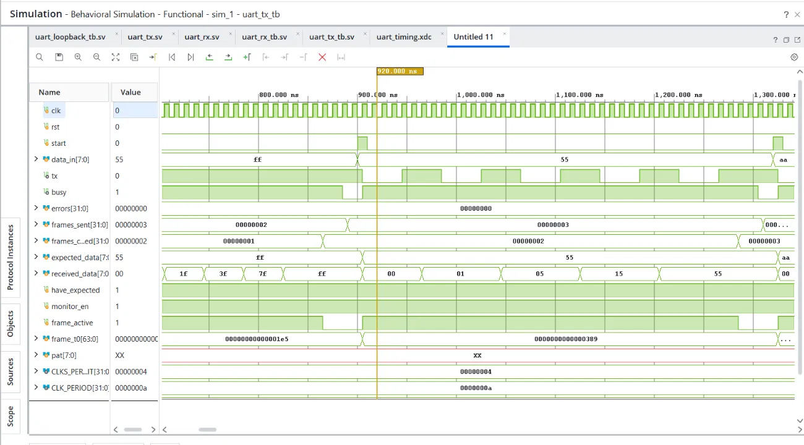

**Receiver: glitches rejected.** Short low pulses on `rx`, far narrower than half a bit, are ignored: `rx_valid` stays low and the valid-frame count does not change.

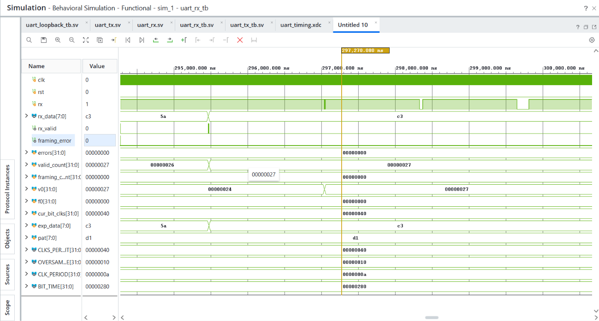

**Receiver: framing error.** A frame with a LOW stop bit raises a single `framing_error` pulse and the byte is discarded.

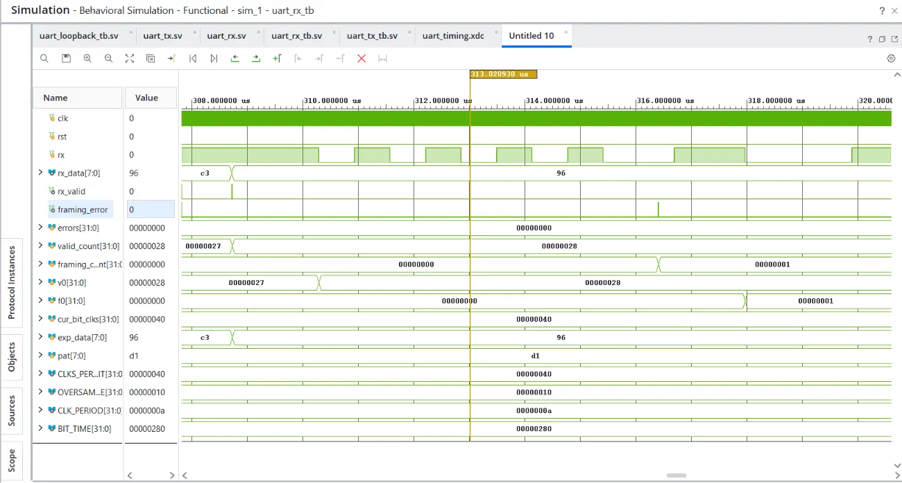

**Loopback: one frame (64 clocks per bit).** The byte sent on `data_in` appears on `rx_data` when `rx_valid` pulses, with no framing error.

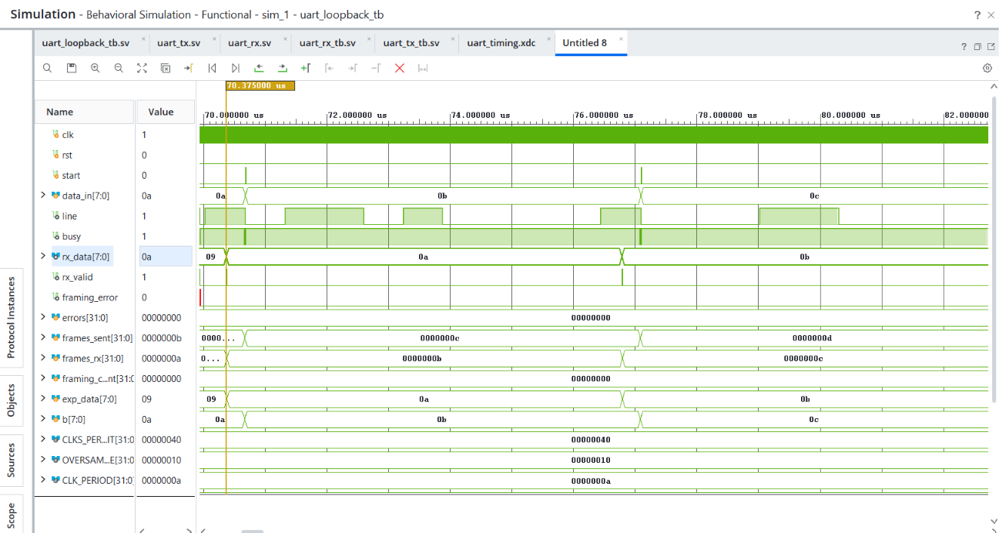

## Simulation logs

| | |
|---|---|
| 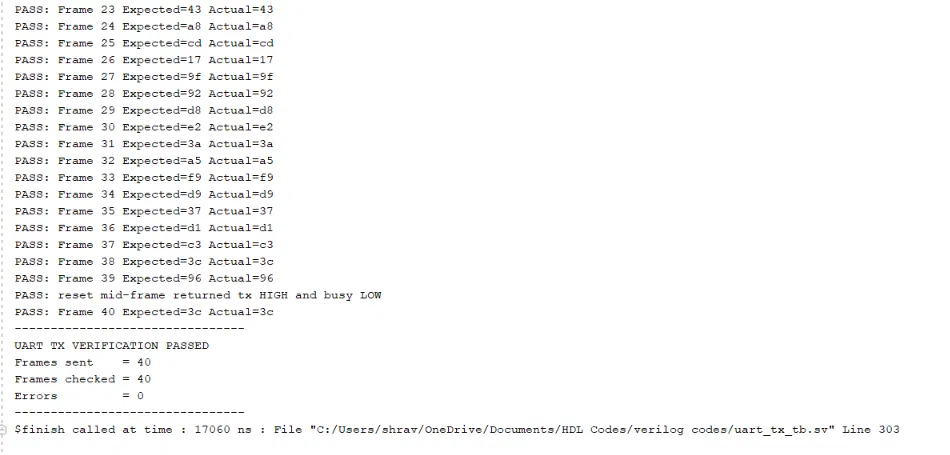 | 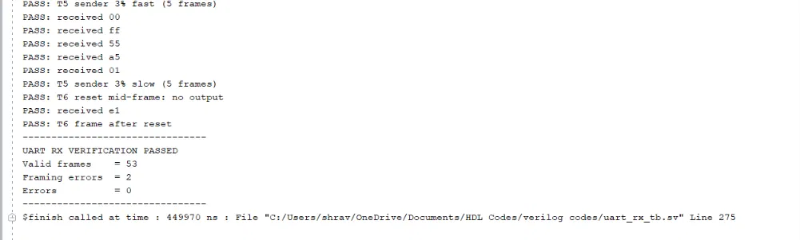 |
| 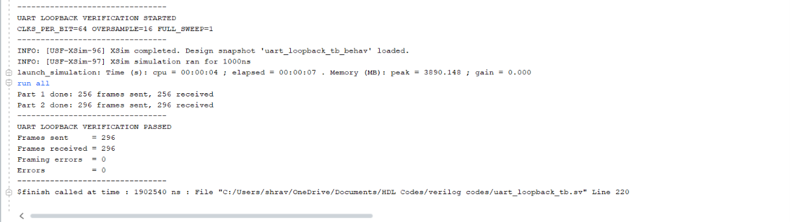 | 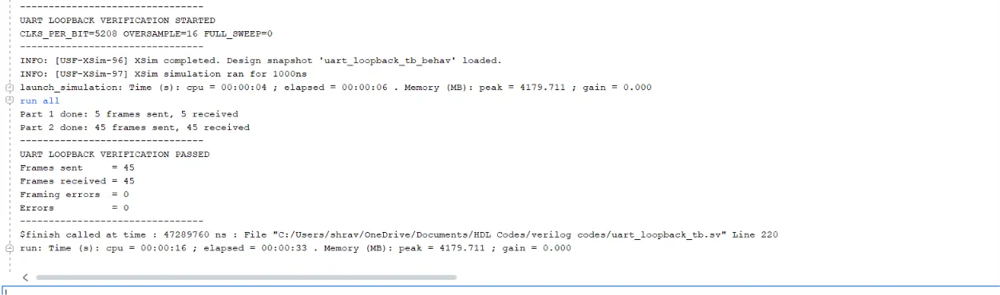 |

## Implementation reports

| | |
|---|---|
| 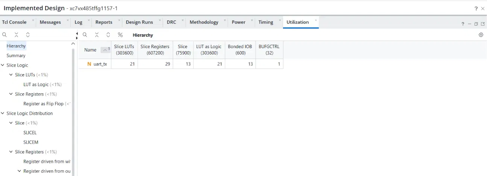 | 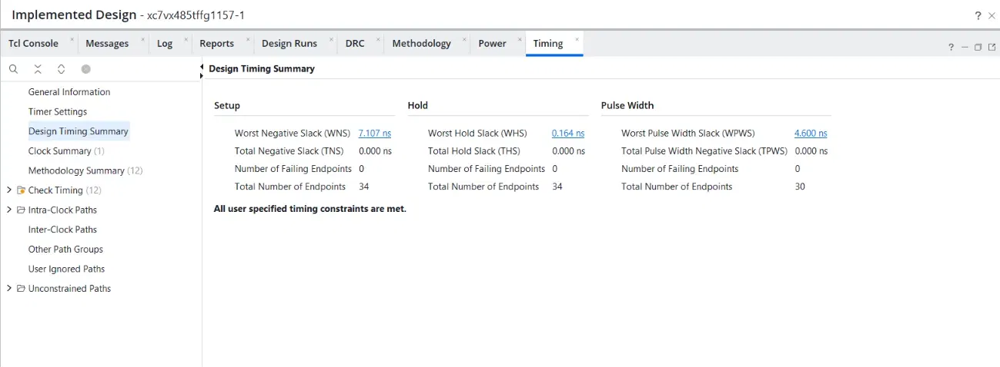 |
| 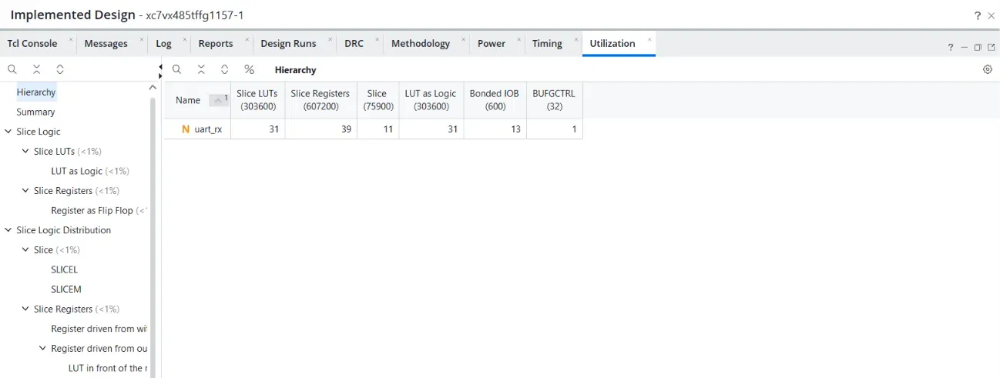 | 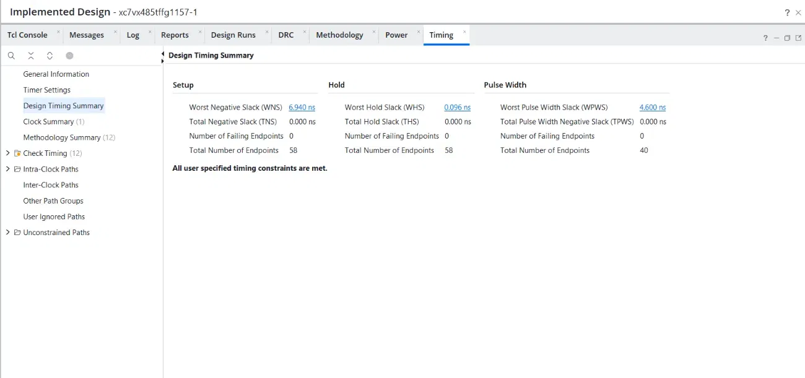 |

## Limitations

- Fixed 8 data bits, 1 stop bit, no parity.
- No FIFOs: `rx_valid` is a one-clock pulse, so the consumer must capture `rx_data` when it is HIGH. There is no overrun detection.
- No hardware flow control (RTS/CTS).
- The transmitter leaves one idle clock between back-to-back frames.
- Verified in simulation and implemented in Vivado only; not tested on an FPGA board.

## Possible extensions

- Parity (8E1/8O1) with a parity error flag
- TX/RX FIFOs with overrun detection
- APB or AXI-Lite register wrapper
- Hardware demo on an FPGA board with a PC terminal
- 
